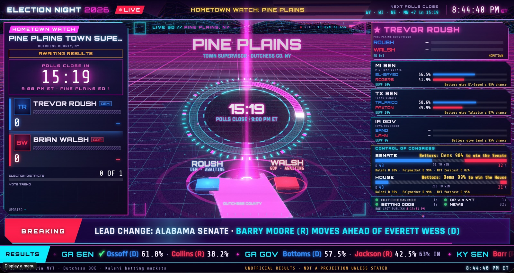

<div align="center">

# 📺 Election Night

**A 3D cable-news results broadcast for your browser, synthwave style, built around the races *you* care about. Your hometown supervisor gets the same treatment as the Senate.**

[](LICENSE)
[](https://nodejs.org)
[](https://threejs.org)
[](#how-it-works)
[](https://claude.com/claude-code)



<sub>Live on election night, Nov 3 2026, at 8:44 PM ET. Polls in the hometown race close in 15 minutes.</sub>

</div>

---

## What it is

On election night the networks spend hours on a handful of swing states, and your town supervisor race never shows up. **Election Night** is a full-screen, self-running broadcast that puts *your* races on the main screen and fits the national picture around them:

- **Hometown watch.** Live town-level results come straight from the county Board of Elections, broken down by election district. There's a 3D terrain model of the town, a "can they still catch up?" outlook, and then-vs-tonight comparisons with past elections.
- **The races you're watching.** Senate, governor and House races come from AP data (via the NYT results feed): county maps, the live forecast, and what share of the expected vote is counted.
- **Betting odds in plain English.** Kalshi and Polymarket odds turn into lines like *"Bettors give El-Sayed a 95% chance"* on every race, plus control of the House and Senate.
- **A real broadcast rundown.** A director rotates segments: Senate Watch (the ladder to 51), The Big Picture (flips and upsets), Ahead of the News (which race gets called next), meme stat cards, and more.
- **Breaking news.** Full-screen alerts fire on race calls, lead changes, Board of Elections uploads and network chamber calls. A scrolling chyron and a results ticker run along the bottom, and headlines come from RSS feeds.
- **Hands-off.** Leave it running on a TV. Every poller backs off on errors, and the page reconnects on its own.

> [!NOTE]
> This was built live **during** the 2026 US midterms, mostly by [Claude Code](https://claude.com/claude-code) working as the show's producer while the results came in. It's tuned to that night's story, but it was designed to be re-aimed. See [Make it yours](#make-it-yours).

## Quick start

```bash
git clone https://github.com/pj4533/election_night.git
cd election_night
npm install
npm start            # live server: http://localhost:4173
```

Open **http://localhost:4173** full screen (it's designed for 16:9, 1920×1080 and up).

No live election tonight? Run the simulator, which plays fake results through the same pipeline:

```bash
npm run sim          # http://localhost:4174, logs to logs-sim/
```

**Controls:** <kbd>Space</kbd> pauses the rotation, <kbd>←</kbd>/<kbd>→</kbd> step through segments, <kbd>1</kbd>–<kbd>9</kbd> jump straight to a segment (the watched races come first), and clicking any tile or panel jumps to it.

## Make it yours

The whole point is to re-aim it at **your** town and **your** races. There are two ways to do that.

### 1. Let Claude Code do it (recommended)

The project was built in a [Claude Code](https://claude.com/claude-code) session, and the repo is set up so the next session can pick it up. [`CLAUDE.md`](CLAUDE.md) holds the architecture, the data-source quirks, and the lessons learned on election night. [`research/`](research/) has a survey of every results API that was tested.

Open a session in the repo and tell it what you care about:

```text
> I live in Ulster County, NY. Make my hometown race the Woodstock Town Supervisor,
  and watch the PA Senate race and the AZ governor race. Rebuild the hometown
  terrain and history for Woodstock.
```

```text
> Start the server and watch the logs. Fix anything that breaks during the night
  without asking me, and if Maine becomes the story, move it up in the rotation.
```

```text
> Add a meme card about turnout in my county, and make the betting odds bigger.
```

On election night you can keep the session open and **direct the broadcast like a producer**: "focus on the Senate now", "the House just got called, drop it", "the hometown results just posted, jump there". Claude edits the rundown, restarts the server and keeps an eye on [`logs/`](#logs). The `scripts/watch.sh` filter exists so a session can tail only the log lines worth acting on.

### 2. Do it by hand

| What | Where |
| --- | --- |
| Watched races, poll intervals, feeds, betting markets | [`server/config.mjs`](server/config.mjs): `WATCH`, `NYT_BASE`, `KALSHI.events`, `NEWS.feeds` |
| Your county's Board of Elections results | `DUTCHESS.base` in `config.mjs`, plus `server/sources/dutchess.mjs` |
| The broadcast rundown (segment order and timing) | `PLAYLIST` in [`public/js/director.js`](public/js/director.js) |
| Poll-closing times | `pollClose` in `WATCH` and `POLLS_FIRST_CLOSE` in `server/store.mjs` |
| Hometown 3D terrain, history, insights and photos | rerun `scripts/build-*.mjs` for your town |

A hometown race is one entry in `WATCH`:

```js
{
  key: 'pineplains', kind: 'dutchess',
  contest: 'Pine Plains Town Supervisor',   // exact contest name from the BOE /data feed
  title: 'Pine Plains Town Supervisor', short: 'PINE PLAINS SUPV',
  place: 'Dutchess County, NY', friend: 'Trevor Roush',
  pollClose: '2026-11-04T02:00:00Z',
},
```

A national race points at its AP/NYT id and, optionally, a Kalshi market:

```js
{ key: 'mi-sen', kind: 'nyt', nytId: 'MI-G-S-2026-11-03', stateFile: 'michigan',
  state: 'MI', fips: '26', title: 'Michigan U.S. Senate', short: 'MI SENATE',
  focus: 'elsayed-a', kalshi: 'SENATEMI-26' },
```

#### Local results: does my county work?

Hometown results come from **Enhanced Voting**, the results platform Dutchess County uses. Plenty of other counties use it too (Orange, Putnam, Ulster, Columbia, Rockland and Westchester in NY alone), and the JSON API is public:

```bash
curl -s https://app.enhancedvoting.com/results/public/api/jurisdictions/<your-county-slug>
```

If your county uses a different vendor (Clarity/Scytl, ElectionStats, or a state site), write another adapter in `server/sources/` that outputs the same normalized race shape. [`research/REPORT.md`](research/REPORT.md) lists the vendors and their feeds, and Claude Code is good at writing the adapter for you.

## How it works

```
 County BOE (Enhanced Voting) ─┐
 AP results via NYT JSON ──────┤                       ┌─ 3D scene (Three.js)
 Kalshi + Polymarket odds ─────┼─► pollers ─► store ─► SSE ─┼─ race cards, boards, tickers
 News RSS / Google News ───────┘   (server/sources)  (diff → events) └─ breaking-news alerts
```

- **The server** (`server/`) runs on Node 24 with no framework. One adapter per source normalizes data into `race → candidates → votes` plus reporting % and a timestamp. The store diffs every update into events (first results, lead change, race call, new Board of Elections upload, polls closed) and pushes state to the browser over Server-Sent Events. The browser never contacts an upstream source.
- **The frontend** (`public/`) is plain ES modules plus Three.js loaded through an importmap, with **no build step**. Each broadcast element is its own module with `update(state)` / `showSegment(seg)` / `onEvent(ev)`. Layout rules are in [`docs/FRONTEND_CONTRACT.md`](docs/FRONTEND_CONTRACT.md).
- **Being polite to sources.** Pollers back off on errors, use ETags, and fetch the big county file only when the publish version changes.

### Logs

`logs/` holds JSON-lines logs: `poll.log` (every fetch), `events.log`, `error.log`, and `client.log` (browser errors and heartbeats). Run `scripts/watch.sh` to filter them down to what matters.

### Deploying (optional)

It runs fine as a single Vercel Fluid Compute function (`api/index.mjs` + `vercel.json`). Run `vercel link` once, then `npm run ship` checks syntax, restarts the local server and deploys to production. Without a Vercel link, `ship` just restarts the local server.

## Data sources & caveats

| Source | What it provides | Notes |
| --- | --- | --- |
| [Enhanced Voting](https://app.enhancedvoting.com) | County and town results, broken down by election district | Official county source. Undocumented public JSON. |
| NYT results JSON (AP) | Senate, governor and House results, county maps, the live forecast | Undocumented. **The NYT terms forbid scraping, so this is for personal use only.** Swap in an AP license for anything public. |
| [Kalshi](https://kalshi.com) / [Polymarket](https://polymarket.com) | Betting odds (probabilities, not votes) | Public market APIs. |
| RSS / Google News | Headlines, and network chamber calls | Calls are detected only from strict headline wording after polls close. |

> [!WARNING]
> Election-night numbers are **unofficial**. The broadcast labels them that way. Don't present it as an official source, and check the terms of every feed before running this publicly.

The endpoints, election IDs and race IDs in this repo are from **2026-11-03**. Undocumented feeds change between elections, so `curl -sI` each one before you rely on it.

## Project layout

```
server/        Node server: config, pollers (sources/), store, SSE, API
public/        Broadcast frontend: js/ modules, js/scene/ (Three.js), css/, geo/ prebaked data
scripts/       build-*.mjs prebakes (terrain, history, insights), ship.sh, watch.sh
research/      Survey of election-results APIs and feeds (start with REPORT.md)
docs/          Frontend contract and screenshots
api/           Vercel function entry point
CLAUDE.md      Context for Claude Code sessions: architecture, quirks, lessons learned
```

## License

Code is released under the [MIT License](LICENSE).

The local photos in `public/geo/local/` come from Wikimedia Commons under their own licenses (CC BY-SA and public domain). Authors and licenses are listed in [`public/geo/local-images.json`](public/geo/local-images.json). Map data is from [us-atlas](https://github.com/topojson/us-atlas). Election data belongs to its respective sources.

<div align="center"><sub>Built on election night by <a href="https://github.com/pj4533">@pj4533</a> and Claude Code. Congrats, Trevor! 🎉🗳️</sub></div>
